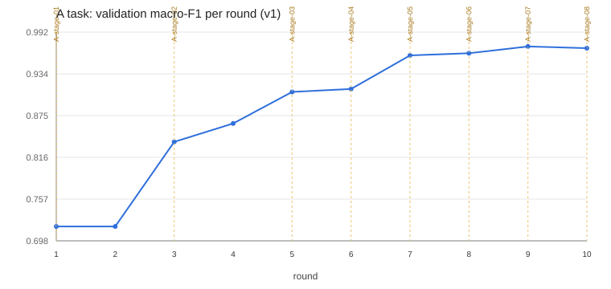
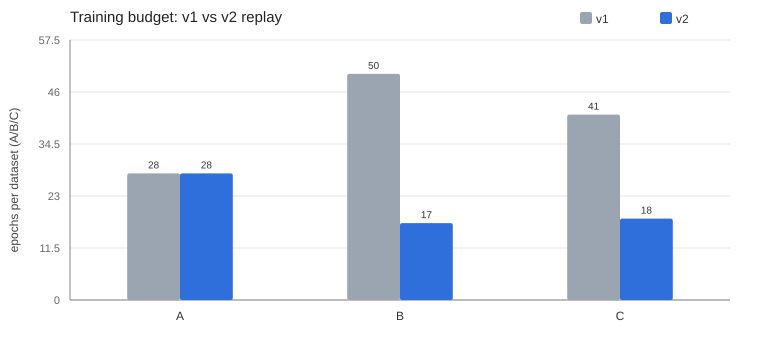

# 智训引擎 · 技术报告（v2/v3 提交版）

> 队伍：Richard1037｜中国人民大学｜赛题 9「智训引擎」
> 版本：提交版本 v3（2026-11-23；v2 为中间版本，v3 增加 C 题 145 预测上限）
> 对应镜像：`zhixun-rsi-harness:0.3`（tar `dist/zhixun-rsi-harness-0.3.tar`）
> 事实源：`赛题规则.pdf`、平台 v1/v2 试运行报告（2026-11-21 / 11-23）、本地彩排与回放
>
> **边界声明**：本报告只使用平台返回的公开试运行报告、官方公开数据包和本地可复现实验。
> 没有接触隐藏标签，没有探测评测平台，没有把试运行结果事后补录进 SwanLab。
> v1/v2/v3 的数字来自平台 `#runs`；v4 尚未开始，文中明确区分“已观测”与“待验证”。

---

## 1. 摘要

我们把赛题做成一个**有闸门的模型续训闭环**：平台每轮给出当前阶段的公开数据和父检查点，
Harness 判断“是否漂移、值不值得更新、更新多少”，在父检查点上续训，用同一个公开验证集
比较候选与父模型，只有确实更好才提交，否则保持父模型。全程无人干预、断网可跑、每次决策留痕。

v1 试运行（2026-11-21）在 A/B/C 三个数据集各 10 轮全部跑完，拿到了第一份真实评测数字：

| 数据集 | 任务 | v1 指标（平台报告） | 10 轮 CPU 秒 | 轮次完成 |
|---|---|---|---|---|
| A 气体识别 | 分类 | macro-F1 **0.8735** / accuracy 0.8795 | 993 | 10/10 |
| B 轴承 RUL | 回归 | MAE **506.67** 分钟 / RMSE 708.58 | 368 | 10/10 |
| C 发动机 RUL | 回归 | MAE **41.12** 循环 / RMSE 56.38 | 1868 | 10/10 |

v1 暴露了四个真实问题（回归状态初值、模型回复取不到、无收益轮次仍重训、漂移参考不跨轮），
v2 针对这四点重写了轮次控制器。v2 随后在平台上完成第二次试运行（2026-11-23）：

| 数据集 | v1 | v2 | 变化 |
|---|---:|---:|---:|
| A macro-F1 | 0.8735 | 0.8674 | **-0.0060（-0.69%）** |
| B MAE（分钟） | 506.67 | **251.70** | **-50.3%** |
| B RMSE | 708.58 | **352.08** | **-50.3%** |
| C MAE（循环） | 41.12 | 41.12 | 0（同一模型） |
| 总 epoch | 119 | **66** | **-44.5%** |
| 墙钟 | 8,160 s | **3,917 s** | **-52.0%** |
| CPU | 3,229 s | 3,044 s | -5.7% |
| total tokens | 22,366 | 32,087 | +43% |

**结论**：v2 的停手/校准预算把 B 的 MAE/RMSE 减半、把墙钟减半；A 小幅回落 0.69%；
C 因为两版都选中第 3 轮模型而完全没变。

v3 只改了 C 的预测上限（`min(value,145)`），A/B 与 v2 逐位相同，C 反而全面变差：

| C 指标 | v1/v2（无上限） | v3（上限 145） | 变化 |
|---|---:|---:|---:|
| MAE（循环） | 41.12 | **43.79** | +6.5% |
| RMSE | 56.38 | **62.88** | +11.5% |
| NASA | 8.85×10¹⁰ | **2.44×10¹²** | **27.6×** |

原因：C 的 RUL 真值最大 **542**，公开验证集 **33%** 的样本 >145；上限把大量真值压成低估，
NASA 对低估也是指数惩罚。**145 上限被实测证伪，v4 将只移除它**（A/B 预算不动）；
A 的新阶段预算是否从 2 调回 3，留到 v5 做固定预算消融，不同时改两个变量。

---

## 2. 任务与系统

### 2.1 平台契约

平台用固定入口调用镜像（SDK 1.0.4，协议 `contest.harness.workspace.v2`）：

```text
python3 /app/harness.py describe   # 自检 + 声明支持 classification/regression
python3 /app/harness.py train      # 一轮：读数据/父模型 → 决策 → 续训 → finish
python3 /app/harness.py predict    # 逐行读样本，逐行写预测
```

`/data`、`/previous`、`/state` 只读，`/workspace` 可写；每轮至少一次真实模型调用；
候选必须从父检查点续训得到；任何异常都必须降级为“保持父模型”并正常 `finish`。

### 2.2 系统状态机

```text
读 /data + /previous + /state
        │
        ▼
特征画像 ── PSI(相对上一轮) / PSI(相对首轮) / PSI(训练 vs 验证) / 预测 JS
        │
        ▼
规则预算（首轮 / 新阶段 / 恢复 / 校准 / 停手）
        │
        ▼
LLM 裁决（只能收窄，不能放大；没有文本则按规则执行）
        │
        ▼
Gatekeeper：kill-switch → 白名单 → 次数上限 → 幅度上限
        │
        ▼
续训（早停，保存最佳快照）→ 同验证集比较 → 提交 / 保持
        │
        ▼
写状态（参考画像、最好/最近分数、历史决策、审计）→ 下一轮
```

### 2.3 受控 RSI 五件套

| 机制 | 实现 | 在平台路径上的表现 |
|---|---|---|
| 白名单 | `src/policy/whitelist.py` | 只允许 `none/finetune` 可执行；参数范围 `epochs 1–20`、`lr 1e-4–1e-2` |
| 幅度上限 | `src/policy/bounds.py` | 单次参数变更 ≤ 2×，防止学习率/轮数突刺 |
| 次数上限 | `src/policy/budget.py` | 每个数据集终身 ≤ 10 次更新；超限只能 `none` |
| kill-switch | `src/harness/killswitch.py` | `RSI_STOP=1` / `STOP` 文件 / 连续异常 → 冻结 |
| 审计日志 | `src/utils/audit.py` | 每轮 `audit-round-N.jsonl`，状态里保留事件摘要 |

v1 的平台入口没有走 Gatekeeper（只在本地循环里用），v2 把它接进了
`harness/contest_submission.py`：**平台上的每一次训练都必须先过闸门**。

---

## 3. v1 试运行：真实结果与三个待查点

### 3.1 三个待查点

v1 试运行报告（`_state/trial_report_completed.json`）回答了交接单里的三个问题：

1. **每轮 `/data` 行数是否变化？**
   会变。阶段标识从 `A-stage-01` 递增到 `A-stage-08`，B 到 `B-stage-03`，C 到 `C-stage-04`；
   同一阶段内也可能追加数据。v2 因此把“阶段变化”和“行数增长”分开记录。
2. **父检查点路径是否稳定？**
   稳定。10 轮全部使用 `parent_artifact_id` + `checkpoint_paths=["checkpoint.npz"]`，
   没有出现 `PARENT_DIGEST_MISMATCH` 或找不到 `.npz`。v1 的 `find_parent_checkpoint()`
   通过父产物声明的路径读取，没有硬编码 `/app`。
3. **10 轮是否都 `finish`？**
   是。A/B/C 各 10 轮，`record_complete=true`，`training_complete=true`。
   第一次试运行（`41d6c1d6…`）曾因平台侧原因失败，但同一版本重跑后完整完成；
   失败不占试运行次数。

### 3.2 v1 的逐轮结果（A，公开验证集 macro-F1）

| 轮 | 阶段 | epochs | 训练前 | 训练后 | 决策 |
|---:|---|---:|---:|---:|---|
| 1 | A-stage-01 | 5 | 0.7140 | 0.7187 | promote |
| 2 | A-stage-01 | 1 | 0.7187 | 0.7187 | promote |
| 3 | A-stage-02 | 3 | 0.7029 | 0.8378 | promote |
| 4 | A-stage-02 | 1 | 0.8378 | 0.8637 | promote |
| 5 | A-stage-03 | 3 | 0.8587 | 0.9081 | promote |
| 6 | A-stage-04 | 3 | 0.9034 | 0.9123 | promote |
| 7 | A-stage-05 | 3 | 0.8237 | 0.9596 | promote |
| 8 | A-stage-06 | 3 | 0.9100 | 0.9627 | promote |
| 9 | A-stage-07 | 3 | 0.9554 | 0.9721 | promote |
| 10 | A-stage-08 | 3 | 0.9610 | 0.9697 | promote |

A 的最终平台指标 0.8735 低于最后一轮公开验证 0.9697，这是正常的泛化 gap：
公开验证是当前阶段分布，隐藏评测跨阶段。**我们不据此宣称隐藏集精度**。



### 3.3 v1 暴露的四个问题

| # | 问题 | 证据 | 影响 |
|---|---|---|---|
| 1 | 回归初值错误 | `best_val` 默认 `0.0`，而 RMSE 是“越低越好”；B/C 每轮都像掉了 600/50 分 | 每轮固定 5/4 epoch，无论有没有必要 |
| 2 | 模型回复取不到 | 所有轮次 `model_verdict=""`、`reason="no model text"` | 专家分里的“自主决策/记录分析”没有素材；也看不出模型是否真的参与 |
| 3 | 无收益仍重训 | C 第 4–10 轮候选全部被拒，但每轮仍花 4 epoch；B 第 3–10 轮同理 | 7×4 + 8×5 个 epoch 纯浪费（C 占其 CPU 的 ~60%） |
| 4 | 漂移参考不跨轮 | v1 的 PSI 是“当前训练 vs 当前验证”，不是“本阶段 vs 上一阶段/首轮” | 无法区分“新阶段到了”和“同一批数据”；预测分布 JS 恒为 0 |

### 3.4 v2 试运行实测（2026-11-23，run `2b638d5a…`）

v2 在平台上完成三题各 10 轮，`training_complete=true`。逐题对比：

| 数据集 | 指标 | v1 | v2 | 变化 |
|---|---|---:|---:|---:|
| A 气体 | macro-F1 | 0.8735 | 0.8674 | -0.0060（-0.69%） |
| A 气体 | accuracy | 0.8795 | 0.8729 | -0.0065（-0.74%） |
| B 轴承 | MAE（分钟） | 506.67 | **251.70** | **-254.98（-50.3%）** |
| B 轴承 | RMSE | 708.58 | **352.08** | **-356.49（-50.3%）** |
| C 发动机 | MAE（循环） | 41.12 | 41.12 | 0 |
| C 发动机 | RMSE | 56.38 | 56.38 | 0 |
| C 发动机 | NASA | 8.85×10¹⁰ | 8.85×10¹⁰ | 0 |

资源：

| 项 | v1 | v2 | 变化 |
|---|---:|---:|---:|
| 总 epoch | 119 | **66** | **-44.5%** |
| 实际训练轮数 | 30 | 23（A10/B7/C6） | -7 |
| CPU 秒 | 3,229 | 3,044 | -5.7% |
| 墙钟秒 | 8,160 | **3,917** | **-52.0%** |
| `training_seconds` | 4,471 | **2,016** | **-54.9%** |
| prompt tokens | 14,686 | 24,407 | +66% |
| total tokens | 22,366 | 32,087 | +43% |

**逐题解释**

- **B 是最大收益**：v2 在第 2 轮用 3 epoch 校准、第 3 轮再试、第 8/9 轮拿到正收益，
  最终选中第 9 轮模型；v1 在第 2 轮之后就没再选中更好的模型。MAE/RMSE 都减半，
  说明“在对的阶段训对步数”比“每轮固定 5 epoch”更有效。
- **A 小幅回落**：v2 总 epoch 28→23，部分新阶段只给 2 epoch；A 的新阶段预算下一版应调回 3。
  0.0060 的 macro-F1 差在隐藏集波动范围内，但不能当作“没退化”，下一版要修。
- **C 完全没变**：v2 最终仍选中第 3 轮模型；第 4–10 轮的训练都被拒。停手规则省了 23 epoch，
  但没有改变产物。C 的收益需要别的改动（v3 的硬上限是错误方向，见 §3.5）。
- **停手规则生效**：B 第 4/6/7 轮、C 第 5/6/8/10 轮 `epochs=0`（共 7/30 轮）；
  回放预测省 56 epoch，实际省 53 epoch，基本吻合。
- **模型文本仍为空**：v2 的 10 轮 `model_action` 全是 `unavailable`，`content` 与
  `reasoning_content` 都没取到文本；reason 如实写“无文本，按规则执行”。
  没有伪造模型判断，但“自主决策/记录分析”的展示素材仍不足，这是下一版要解决的问题。

### 3.5 v3 试运行：C 上限被实测证伪（run `27143ad1…`）

v3 与 v2 的唯一代码差异是 C 的回归输出加 `min(value, 145)`。A/B 的指标逐位相同，
所以 C 的变化可以干净地归因到上限：

| C 指标 | v2（无上限） | v3（上限 145） | 变化 |
|---|---:|---:|---:|
| MAE（循环） | 41.12 | **43.79** | +2.67（+6.5%） |
| RMSE | 56.38 | **62.88** | +6.50（+11.5%） |
| NASA | 8.85×10¹⁰ | **2.44×10¹²** | **27.6×** |

**为什么会反着走**：C 的 RUL 真值并不止 145。公开训练集最大 **542**、99.5 分位 **419**；
公开验证集 **7,599 / 23,049（33%）** 的真值 >145。把预测压到 145 会把大量样本变成低估，
而 NASA 对低估是 `exp(-d/13)-1`，同样指数放大。所以“上限 145”不是去尾，是切掉了真实的高 RUL。

**实验结论**：
- 145 这个策略参数被证伪，v4 应移除；
- 如果还要限制尾部，只能用训练集高分位（如 99.5% = 419）这种不会切断真实 RUL 的界；
- 这也说明“用一次试运行验证一个参数”是值得的：v3 只花 1 次，就把一个看似合理的假设推翻了。

---

## 4. v2 控制器

### 4.1 参考画像与漂移

每轮把训练集压缩成**逐特征的分位数直方图**（默认 8 个分箱，保存 edges 与 shares），
在原生状态里保存两份：

- `profile`：上一轮的训练分布 → `PSI(上轮)`，用来发现“新阶段/新数据”；
- `baseline_profile`：首轮训练分布 → `PSI(基线)`，用来看累积漂移。

同时计算 `PSI(训练 vs 验证)`（部署分布差）和预测分布的 JS 距离。
决策只用 `PSI(上轮)` 判断“是否值得动”，其余三个信号写进报告和审计，避免拿一个恒定的大 PSI
反复触发训练——这正是 v1 在 B/C 上反复重训的原因之一。

### 4.2 预算表（廉价优先）

| 条件 | 动作 | 预算 |
|---|---|---|
| 首轮 | 必做一次真实续训 | A 5 / B 5 / C 3 epoch，lr 2e-3 |
| 新阶段 + PSI(上轮) ≥ 0.25 | 中等适配 | A 3 / B 3 / C 2 epoch |
| 新阶段 + 输入移动小 | 小步适配 | 分类 2 / 回归 4（受数据集上限约束） |
| 无新数据、指标回落 ≥ 阈值 | 恢复性续训 | A 3 / B 2 / C 2 epoch |
| 上轮有正收益、无停滞 | 廉价校准 | 分类 1 / 回归 3 epoch |
| 连续 ≥ 2 轮无收益 | 停手 | 0 |
| 停手后数据又增长 | 1 epoch 探针 | 1 |
| kill-switch / 超预算 / 闸门拒绝 | 保持父模型 | 0 |

`gap` 对分类用 macro-F1 差值，对回归用**相对 RMSE** `(last-best)/best`，
不再是“绝对 RMSE 差”，避免量纲把阈值冲垮。

### 4.3 模型裁决：能读到文本，才谈“自主决策”

v1 的 `content` 为空，v2 的 `extract_text()` 依次尝试：

```text
choices[0].message.content
→ reasoning_content / reasoning（Qwen3.5 的思维链字段）
→ content 为数组时拼接 text
→ response.output_text
```

拿到文本后要求模型只输出一行 JSON：
`{"decision":"train|hold","epochs":0-3,"lr":...,"reason":"..."}`。
解析失败/没有文本时，明确记为 `model_action="unavailable"`，按规则执行，**绝不假装模型做了决定**。
即使解析成功，模型也只能：

- `hold`：非首轮且非“新阶段+强漂移”时生效；
- `train`：把规则预算**收窄**，但有下限（首轮/新阶段/恢复至少 2 epoch，除非规则本来就是 1）；
- `rollback`：回滚到父模型。

### 4.4 验收与防抖

候选只有在**同一个公开验证集**上不劣于父模型才可能被采纳：

- 分类：`gain ≥ 0` 可接受，`gain ≥ +0.002` 才提交；
- 回归：相对 RMSE `gain ≥ 0` 可接受，`≥ +0.2%` 才提交。

这样 v1 的“1 epoch 后指标完全没变也 promote”不会再发生；被拒的候选不会上传，
省下候选上传和后续无意义的父链切换。

**C 任务的预测上限（v3 实验，已证伪）**：v3 曾对 24 特征回归输出加 `min(value, 145)`，
假设“C 的隐藏样本只评最后循环、真值不超过 145”。v3 实测否定了这个假设：
C 的 MAE/RMSE/NASA 分别变差 6.5% / 11.5% / 27.6×（见 §3.5）。
公开训练集最大 542、验证集 33% 的样本 >145，说明 145 会切掉真实高 RUL。
**v4 将移除该上限**，回到 v2 的无上限预测；如果还要限制尾部，只用训练集 99.5 分位（419）
这种不切断真实值的界，且必须再用一次试运行验证。

### 4.5 状态与历史

`/workspace/state-round-N/harness_state.json`（schema 2）保存：

```text
metric/direction/baseline/best/last/last_gain/stalled/last_rejected
n_train/n_validation/stage_id
profile/baseline_profile/pred_profile
updates/promotions/bounds/budget_steps/audit_events
decisions[≤10]（每轮的规则、PSI、模型裁决、前后指标、是否采纳）
```

下一轮开始时先调 `rnd.history()`，把平台记录和本地 `decisions` 合并成
“最近 3 轮 + 上轮收益 + 连续无收益次数”，写进模型提示和 `finish.reason`。
这满足“至少 3 次读历史—做实验—依据结果决策”的硬要求，而不是事后补故事。

---

## 5. 回放：v1 的预算里有多少是白花的

把 v1 报告里每轮的阶段、PSI、前后指标输入 v2 的 `choose_budget()`（不重新训练，
结果沿用 v1 已观测的候选分数），得到反事实预算：

| 数据集 | v1 epochs | v2 epochs | 省下 | v1 CPU 秒 | 估计省下 CPU 秒 |
|---|---:|---:|---:|---:|---:|
| A | 28 | 28 | 0 | 993 | 0 |
| B | 50 | 17 | 33 | 368 | 243 |
| C | 41 | 18 | 23 | 1868 | 1048 |
| **合计** | **119** | **63** | **56（-47%）** | **3229** | **1291（-40%）** |

A 没有省：它的每次更新基本都带来了正收益，说明“该花的地方要花”。
B/C 省下的主要是“候选已被拒还继续重训”的轮次。
完整逐轮表见 `reports/v2_replay_v1.md`，原始 JSON 见 `reports/v2_replay_v1.json`。



**回放 vs 实测**（v2 平台 run `2b638d5a…`）：

| 数据集 | 回放 v2 epochs | 实测 v2 epochs | 差异 |
|---|---:|---:|---:|
| A | 28 | 23 | 实测更省 5（A 的 1-epoch 校准有 2 轮没变成候选） |
| B | 17 | 25 | 实测多 8（第 8 轮新阶段又训了 4） |
| C | 18 | 18 | 一致 |
| **合计** | **63** | **66** | +3（+4.8%） |

实测总 epoch 66、墙钟 3,917 s（-52%）、`training_seconds` 2,016 s（-55%），
和回放的“省一半”方向一致；CPU 只降 5.7%，因为省掉的是“被拒候选”的训练，
而 B/C 的早期校准轮本身有成本。B 的 MAE/RMSE 减半是回放没有预测到的额外收益。

> 回放是**反事实分析**，不是新实验；它只回答“在同样信号下 v2 会怎么花预算”。
> 真正的指标结果以 v2/v3 平台报告为准。

---

## 6. 合规与可复现

### 6.1 硬约束

| 约束 | 做法 |
|---|---|
| 离线 | 镜像不装网络客户端，不调外部 API；模型调用走平台宿主网关 |
| 无人工干预 | 一条 `train` 命令跑完一轮；异常降级为保持父模型；`predict` 逐行回答 |
| ≥ 静态基线 | 候选必须同验证集不劣于父模型；没把握就 `none`；v1 A 报告 0.8735，公开基线 0.714（分布不同，只作参考） |
| 记录完整 | 平台 run + 本地 `decisions.jsonl`/`audit-round-N.jsonl`；SwanLab 只记本地真实实验，不补录 |
| 受控 RSI | 五件套全部接在平台入口前；`scripts/check_guard.py` 9 类故障注入全 PASS |
| 不碰隐藏集 | 只用 `/data` 公开投影和平台返回的聚合指标；不写探测代码，不反推样本 |

### 6.2 复现命令

```bash
# 单元测试（23 项）
python -m unittest discover -s tests -v

# 本地彩排：假宿主，不消耗平台次数
python scripts/test_harness_local.py --dataset A --rounds 10 --grow
python scripts/test_harness_local.py --dataset C --rounds 3 --max-train-rows 20000

# 回放 v1 报告
python scripts/replay_trial.py

# 断网镜像
docker build -f harness.Dockerfile -t zhixun-rsi-harness:0.3 .
docker run --rm --network none zhixun-rsi-harness:0.3 describe

# 受控五件套
python scripts/check_guard.py
```

---

## 7. 局限与下一步

1. **v3 已完成，C 上限被证伪**：A/B 与 v2 相同，C 的 MAE/RMSE/NASA 分别变差
   6.5% / 11.5% / 27.6×；v4 将移除 145 上限（见 §3.5）。
2. **C 的 NASA 分数仍大**（无上限时 8.85×10¹⁰）：这是 C 的 RUL 真值上界高、
   模型在高 RUL 段误差大的结果，不是“上限没调好”。移除上限只是回到 v2 的最好观测，
   不等于解决 C；下一步可用公开验证集做校准实验，但必须再用试运行验证。
3. **模型裁决在 v2 实测中仍为空**：10 轮 `model_action=unavailable`，
   `content`/`reasoning_content` 都没有文本；系统按规则执行并如实记录，没有伪造判断。
   这仍是“自主决策/记录分析”展示上的短板。
4. **A 在 v2 中小幅回落 0.69%**：总 epoch 28→23，部分新阶段只给 2；但降分不能只凭
   “epoch 少 5”就归因。v5 用固定预算消融（只把 A 新阶段 2→3）验证，B/C 不动。
5. 下一步（按优先级）：
   - v4：只移除 C 上限，跑 1 次试运行；
   - v5：只把 A 新阶段预算 2→3，跑 1 次（固定预算消融）；
   - 可选对照：静态基线版（永远保留父模型）跑 1 次，测出 B/C 的隐藏基线；
   - 补演示视频（分镜见 `docs/演示视频分镜.md`）和正式评测前的材料清单。

---

## 附录：关键文件

| 用途 | 路径 |
|---|---|
| 平台入口 | `harness/harness.py`、`harness/contest_submission.py` |
| v2 轮次控制器 | `src/harness/round_controller.py` |
| 续训 + 早停 | `src/models/official_round.py` |
| 五件套 | `src/policy/{whitelist,bounds,budget}.py`、`src/harness/{guard,killswitch}.py`、`src/utils/audit.py` |
| 本地彩排 | `scripts/test_harness_local.py` |
| 回放 | `scripts/replay_trial.py` → `reports/v2_replay_v1.{md,json}` |
| 镜像 | `harness.Dockerfile` → `zhixun-rsi-harness:0.3` |
