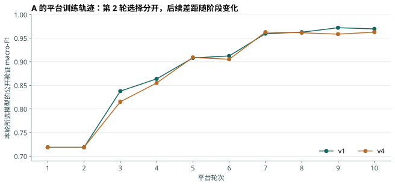
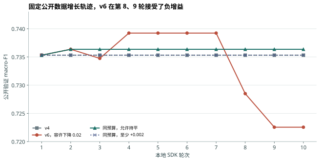

# 智训引擎技术报告 · v6 对照与 v7 方案

**校赛 A 单题主包选 v6；A/B/C 三题综合推荐 v5。** v6 的 A macro-F1 为 0.873469，v5 为 0.867426。v5 的 B/C 隐藏 RMSE 分别为 352.083 和 54.961，均优于 v6 的 569.046 和 56.315。v7 已在本地保留 v6 的 A、取消 B 上界并恢复 v5 的 C 校准。公开 B 逐条恢复参考预测，200 条隐藏样本的分数仍待验证。暂缓试运行，剩余 4 次。[本地验证](版本方案/v7.md)

## 1. 平台 A 的六版对照

| 版本 | 平台试运行状态 | A 隐藏 macro-F1 | A 隐藏 accuracy | 请求 epoch | 晋升轮次 |
|---|---|---:|---:|---:|---|
| v1 | 完成 | **0.873469** | **0.879451** | 28 | 1–10 |
| v2 | 完成 | 0.867426 | 0.872902 | 23 | 1、3、4、5、7、8、9、10 |
| v3 | 完成 | 0.867426 | 0.872902 | 23 | 同 v2 |
| v4 | 完成 | 0.867426 | 0.872902 | 23 | 同 v2 |
| v5 | 完成 | 0.867426 | 0.872902 | 23 | 同 v4 |
| v6 | 完成 | 0.873469 | 0.879451 | 28 | 1–10，与 v1 相同 |

v1 与 v6 的 A 并列最高，领先 v4 **0.006043 macro-F1**。v1 在新增训练行时请求 3 epoch，在安静轮请求 1 epoch。v4 在部分新阶段降为 2 epoch，同时要求候选宏平均 F1 增益至少 0.002 才晋升。两项改动共同改变了传给下一轮的权重和优化器状态。

| 平台公开验证节点 | v1 | v4 | 观察 |
|---|---:|---:|---|
| 第 2 轮，阶段 1 | 0.718735，晋升 | 0.718735，保留父模型 | 验证分相同，选择路径首次分开 |
| 第 3 轮，阶段 2 | 0.837793 | 0.815223 | 两版本轮都请求 3 epoch，显示上一轮选择值得追踪 |
| 第 6 轮，阶段 4 | 0.912347，晋升 | 0.905230，保留父模型 | v1 请求 3 epoch，v4 请求 2 |
| 第 7 轮，阶段 5 | 0.959568 | 0.962836 | v4 在这一阶段领先，差距随数据分布变化 |
| 第 10 轮，阶段 8 | 0.969707 | 0.962674 | 最后一轮公开验证和最终隐藏集均由 v1 领先 |

这解释了 v1 优势可能从哪里累积。平台试运行没有做预算与晋升门槛的独立消融，单次隐藏成绩不足以断定哪项改动贡献了多少，也不足以推出“A 越少更新越好”。跨阶段验证样本不同，图内宜在同一轮横向比较。

## 2. v4 与 v6 的同条件十轮复现

使用官方 SDK 1.0.4、相同起始检查点与公开验证集。训练行数从 40% 增至 100%，每三轮切换阶段，模型回执设为空以激活规则兜底。每轮重载父检查点，最终使用各自已选模型评估。这个增长安排用于配对实验，与平台后续分批揭示的数据有差异。

| 公开指标 | v4 | v6 | v6 − v4 |
|---|---:|---:|---:|
| A macro-F1 ↑ | 0.735318 | 0.722549 | −0.012770 |
| A accuracy ↑ | 0.885852 | 0.882637 | −0.003215 |
| B MAE ↓（分钟） | 541.689 | 541.376 | −0.313 |
| B RMSE ↓（分钟） | 649.635 | 649.239 | −0.396 |
| C MAE ↓（循环） | 38.130 | 38.138 | +0.008 |
| C RMSE ↓（循环） | 51.602 | 51.608 | +0.006 |
| C NASA ↓ | 3.51886×10⁹ | 3.50256×10⁹ | −0.46% |

在这条本地数据流上，B/C 两版最终检查点的**未截断预测指标相同**。B 有 3 条预测触及 1,200 分钟，C 有 84 条触及 260 循环，表中两题差异都能由预测出口的开关复现。另用最多 4,000 条训练记录进行逐轮增长压力测试，A/B/C 最终分别累计 28、25、13 个请求 epoch，合计 66。v4 平台实测为 23、25、18，合计也是 66。[配对实验数据](试运行证据/v4-v6公开配对对照.json)

### A 的单变量实验

固定 v6 的数据、起始权重、学习率、训练预算和训练过程，只切换晋升门槛。允许持平时采用浮点误差容差 10⁻⁹。

| 策略 | 最终公开 macro-F1 | 晋升次数 | 观察 |
|---|---:|---:|---|
| v6 原样，允许下降 0.02 | 0.722549 | 6 | 第 8、9 轮分别接受 −0.010736、−0.005949 |
| 仅改为允许持平 | **0.736363** | 3 | 第 2 轮的 +0.001044 得到保留，第 4 轮持平 |
| 仅改为至少 +0.002 | 0.735318 | 1 | 第 2 轮的小幅正增益也被拦下 |

v6 第 4 轮曾到 0.739233，后两次允许退步的晋升拉低了最终结果。为核查顺序敏感性，额外打乱同一批次的 445 条训练记录，保留同一验证集、十轮增长率与训练预算，各策略使用相同随机顺序。

| 训练行顺序 | v6 容许 −0.02 | 允许持平 | 至少 +0.002 |
|---|---:|---:|---:|
| 原始顺序 | 0.722549 | **0.736363** | 0.735318 |
| 打乱，种子 7 | 0.726166 | 0.725423 | **0.729886** |
| 打乱，种子 42 | 0.724213 | **0.725782** | 0.719784 |

允许持平在这三次中的最低 F1 为 0.725423，高于另外两档各自的最低值。“至少 +0.002”在种子 7 上最好、在种子 42 上最差。三种顺序来自同一公开批次，下一步验证重点是**跨批次**的稳定性。[原始顺序逐轮记录](试运行证据/A验收门槛十轮对照.json) · [补充顺序逐轮记录](试运行证据/A验收门槛补充顺序.json)

## 3. C 的 NASA 截断开关

固定 v4 对应的公开阶段 1 第 3 轮网络，在同一批 23,049 条记录上只改变输出上界。NASA 对少数大误差给予指数惩罚。

| 上界（循环） | 被截条数 | MAE | RMSE | NASA |
|---|---:|---:|---:|---:|
| 无上界 | 0 | 37.856 | 51.691 | 4.321×10⁹ |
| 145 | 7,617 | 40.537 | 58.158 | 7.346×10¹⁰ |
| 220 | 762 | 37.945 | 51.936 | 4.275×10⁹ |
| 260 | 90 | 37.862 | 51.695 | 4.304×10⁹ |
| 300 | 0 | 37.856 | 51.691 | 4.321×10⁹ |

145 将公开 NASA 放大约 17 倍；平台上的 v3 相对 v4 则放大约 27.56 倍。260 在同一公开检查点上让 NASA 下降约 0.38%，RMSE 轻微上升。两次公开对照都表明，温和截断只能改变少数输出。v5 工况残差在同一公开对照上的 RMSE 为 50.049、NASA 为 2.378×10⁹，v5 的隐藏 RMSE 54.961、NASA 6.741×10¹⁰，较 v4 分别降低 2.52%、23.86%。[固定检查点阈值扫描](试运行证据/v6公开截断对照.json)

## 4. v6 隐藏结果与 v7 决定

v6 的隐藏 A macro-F1 为 0.873469；B MAE/RMSE 为 426.771/569.046 分钟；C MAE/RMSE 为 41.085/56.315 循环，NASA 为 8.8496×10¹⁰。 v7 已本地定稿：A 保留 v6，B 取消 1,200 分钟上界，C 恢复 v5 的 ±10 工况校准且输出无固定上界。公开 B 逐条恢复无上界参考预测。v7 仅有公开验证成绩。 [平台回执](试运行证据/v6.json) · [v7 逐项验证](版本方案/v7.md)

## 5. 局限：B 隐藏分差的两种可能解释

本地十轮在同一批 1,679 条公开验证记录上，只切换 v5/v6 的 B 预算规则：固定 1,200 分钟上界时，两组 RMSE 均为 649.239；固定 2,500 时均为 649.635。固定 1,200 并回放平台实际的 v5 25 个、v6 19 个 epoch，结果仍同为 649.239。预算和截断在这条公开数据流上都未重现隐藏 RMSE 的差距。[本地归因回执](试运行证据/B预算归因_本地十轮.json)

1. **每轮公开投影可能随运行变化。** 平台第 8 轮，两版均训练 4 个 epoch。v5 验证 RMSE 改善 0.3297%，候选晋升；v6 恶化 0.0991%，保留父模型。两次运行的公开样本或顺序可能不同。回执缺少可用于跨运行对齐的逐条记录，无法确认投影是否发生变化。[v5 回执](试运行证据/v5.json) · [v6 回执](试运行证据/v6.json)
2. **隐藏 B 的样本波动可能较大。** v5、v6 各有 200 条隐藏预测，少数大误差即可拉高 RMSE。v6 的 569.046 分钟可能包含一次评测的波动。缺少逐条误差和同配置重复评测，无法估计方差，也无法将两版的差距量化归因给抽样波动。

## 6. 最终选择表

| 评审口径 | 采用版本 | 平台隐藏试运行依据 | 稳定性说明 |
|---|---|---|---|
| 只评 A（校赛） | **v6** | A macro-F1 **0.873469**，v5 为 0.867426。 | v6 与 v1 并列已测最好。 |
| A/B/C 三题综合 | **v5** | B RMSE **352.083 分钟**、C RMSE **54.961 循环**，v6 对应为 569.046、56.315。 | B 跨运行稳定性尚未量化。推荐依据已测分项表现，平台未给出统一加权总分。 |
